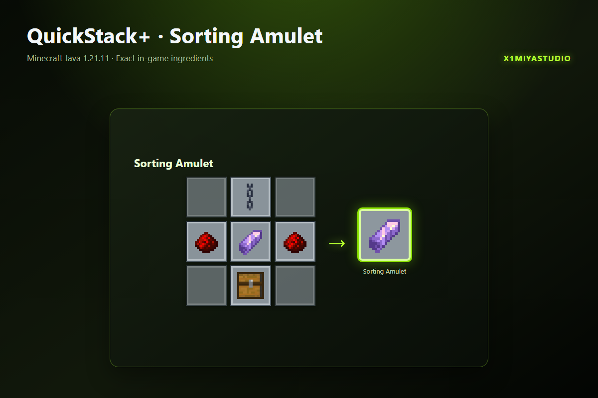

# QuickStack+

  
  

QuickStack+ moves matching inventory stacks into nearby storage with one click. Containers receive only items they already contain, so an organized storage room stays organized.

## Features

- Searches chests, trapped chests, and barrels within 16 blocks.
- Leaves unmatched items in the player's inventory.
- Activates only when the Sorting Amulet is used.
- No passive tick function.

## Crafting

Craft the Sorting Amulet with an iron chain above, redstone on both sides, an amethyst shard in the center, and a chest below.

## Use

Right-click with the Sorting Amulet to run a storage pass. The amulet is returned after activation.

For creative testing, `/function x1_quickstack:core/give_amulet` is still available.

## Installation

Place the ZIP in `<world>/datapacks/`, then run `/reload`.

Minecraft Java Edition **1.21.11** · Vanilla datapack · Namespace `x1_quickstack` · All Rights Reserved · X1miyaStudio
