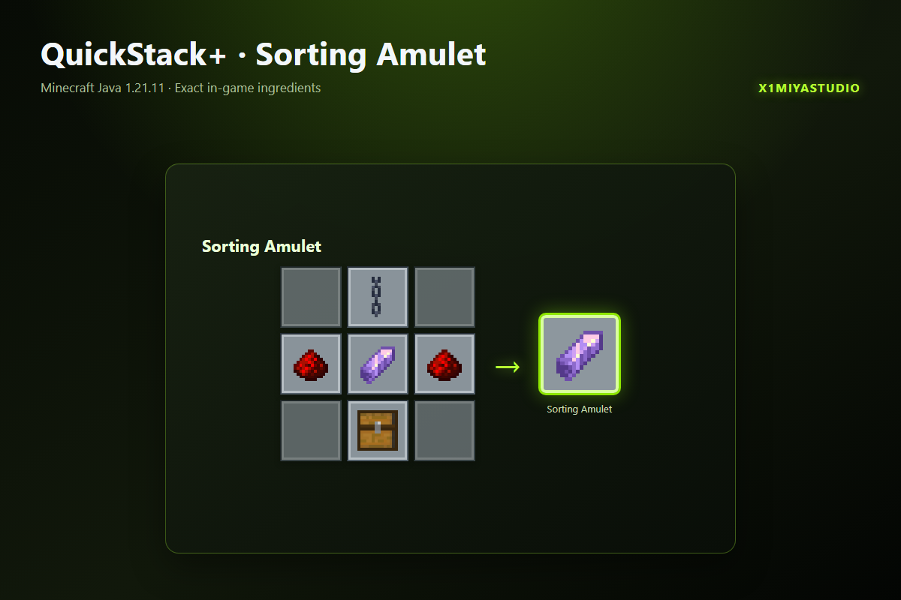

# QuickStack+

  
  

QuickStack+ одним нажатием переносит совпадающие стаки из инвентаря в ближайшие хранилища. Контейнер получает только те предметы, которые уже в нём есть, поэтому порядок сохраняется.

## Возможности

- Ищет сундуки, сундуки-ловушки и бочки в радиусе 16 блоков.
- Оставляет несовпадающие предметы в инвентаре игрока.
- Работает только при использовании Амулета сортировки.
- Не использует пассивную тиковую функцию.

## Крафт

Создай Амулет сортировки: железная цепь сверху, редстоун по бокам, осколок аметиста в центре и сундук снизу.

## Использование

Нажми ПКМ с Амулетом сортировки, чтобы запустить перенос. После активации амулет возвращается.

Для творческого тестирования по-прежнему доступна команда `/function x1_quickstack:core/give_amulet`.

## Установка

Помести ZIP в `<мир>/datapacks/`, затем выполни `/reload`.

Minecraft Java Edition **1.21.11** · Ванильный датапак · Namespace `x1_quickstack` · All Rights Reserved · X1miyaStudio
